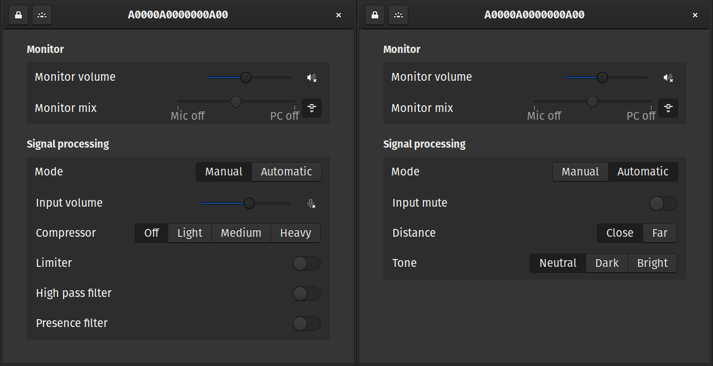

# mv7config

Unofficial utility for configuring Shure MV7 microphones.

Run it by either importing the (desktop file)[res/re.delab.mv7config.desktop] or `python gui.py`
# Setup
Place the (42-shure-mv7.rules)[res/42-shure-mv7.rules] in `/etc/udev/rules.d` so the script does not need root access, reboot if neccessary.
Install the required python packages into your python environment with `pip install -r requirements.txt`, consider creating a venv for that.
